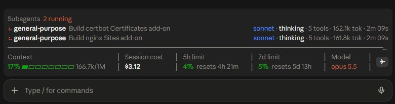
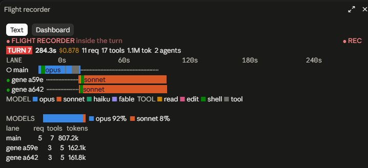

# claude-usage-mods

Three Claude Code mods for keeping an eye on usage, cost and subagents while you work.

| Mod | What it does | Toggle |
|---|---|---|
| `usage-band` | One-line band above the prompt: context fill, session cost, rate limits, model | `/usageband` |
| `agents-band` | Live rows for running subagents, stacked above the usage band | `/agentsband` |
| `flight-recorder` | Pane with a live timeline of each turn, per lane (main + subagents) | `/flight-recorder` |

## usage-band and agents-band



**usage-band** is the bottom row. It answers "how much room and budget do I have left?" without running `/usage` or `/context`:

- **Context** - how full the context window is (percent, bar, tokens used / window size).
- **Session cost** - what this session has cost so far.
- **5h limit / 7d limit** - percent used of each rate limit, with a countdown to its reset.
- **Model** - the model the main loop is running.
- **✈ button** - opens the flight recorder pane, shown only when `flight-recorder` is loaded.

Percentages turn yellow at 50% and red at 80%. The band refreshes while you are idle, so the countdowns stay accurate, and it steps aside when a survey or question takes that spot.

**agents-band** is the top block. It appears only while subagents exist, so it costs no space the rest of the time. Each row shows one subagent:

- spinner while running, `✓` when done, `✗` when failed
- agent type and the task it was given
- model, then what it is doing right now (`thinking` or `▸ ToolName`)
- tool calls so far, tokens, elapsed time

The header counts running and finished agents. A finished agent stays visible for 20 seconds, then drops off. Up to 6 rows are shown.

**Linked sessions** (desktop app only). Sessions this one started with `start_session`, and the ones those started, get a block of their own under the subagents:

- spinner while the session is working, `○` when idle
- its short name and title
- model, `working` or `idle Nm ago`, and context fill (`ctx 23%`)

The data comes from the desktop app's `ccd_session_mgmt` MCP server (`list_sessions` with `linked: true`, `get_session`, `get_usage`), polled every 5 seconds. Archived sessions, the parent and sibling sessions are left out. In a terminal session that server does not exist: the first call says so and polling stops. Unlike subagents, a session's current tool and token count are not shown, since the server does not report them.

## flight-recorder



A side pane that records what happens inside each turn, so you can see where time and tokens went:

- **Turn header** - turn number, duration, cost, model requests, tool calls, total tokens, subagent count.
- **Lane timeline** - one row per lane: `main` plus each subagent (`gene a59e` = general-purpose agent `a59e…`). Bars are model requests, colored by model (opus, sonnet, haiku, fable). Tool calls are drawn on top, colored by kind (read, edit, shell, other). Dots mean nothing was running in that lane at that moment, for example main idle while its subagents work.
- **MODELS** - token share per model family for the turn.
- **Per-lane table** - requests, tool calls and tokens for each lane.

In the screenshot, main (opus) used 92% of the tokens for the turn and the two sonnet subagents only 8%. A spend split like that is the thing this pane makes easy to see.

Two views: **Text** (default, works in the terminal too) and **Dashboard** (SVG charts: cost per turn, tokens by model, top tools; desktop only). `/flight-recorder text` or `/flight-recorder dashboard` opens the pane on that view. Earlier turns are kept below the current one.

## Install

1. Clone the repo anywhere, for example `~/.claude/mods`.
2. Point `CLAUDE_CODE_PLUGIN_DIRS` at the mods you want (`;` on Windows, `:` elsewhere), for example in `~/.claude/settings.json`:

```json
{
  "env": {
    "CLAUDE_CODE_PLUGIN_DIRS": "/path/to/usage-band:/path/to/agents-band:/path/to/flight-recorder"
  }
}
```

3. Restart Claude Code.

## Layout

Each mod has the same shape:

- `.claude-plugin/plugin.json` - manifest
- `hooks/hooks.json` + `hooks/register.tsx` - the mod itself
- `tests/` - tests using `claude-code/testing`
- `types/index.d.ts` - the mod's own public types

`.claude-plugin/types/` holds the Claude Code SDK type stubs. They are generated locally and git-ignored, so `tsconfig.json` only resolves once Claude Code has regenerated them (for example by asking it to work on the mod).
