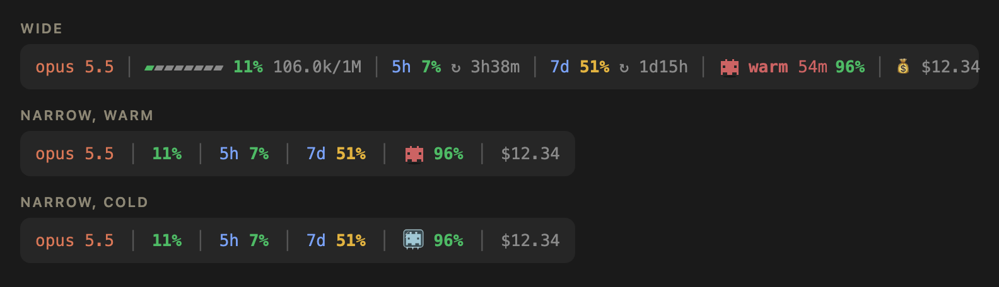
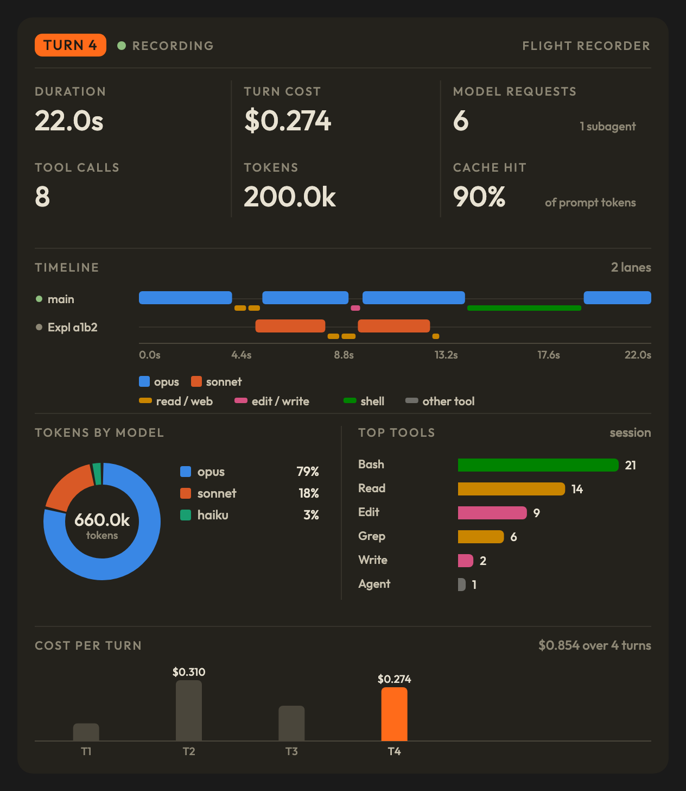
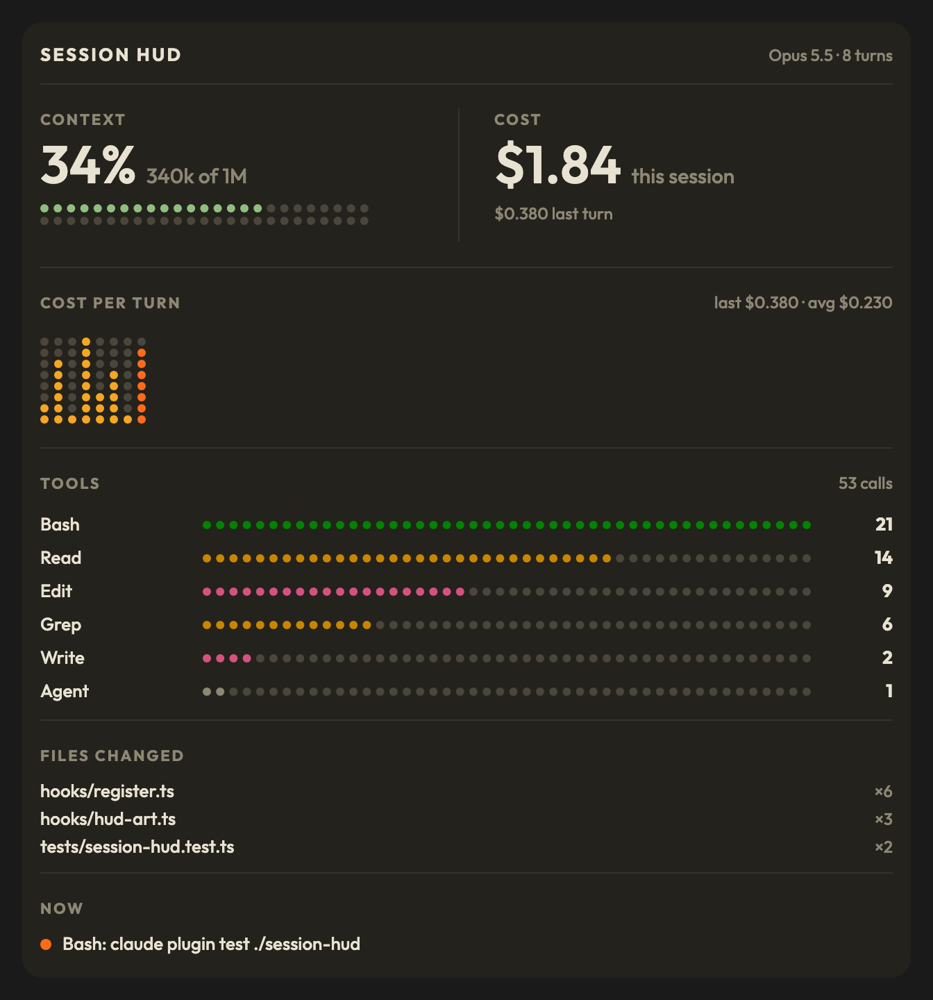
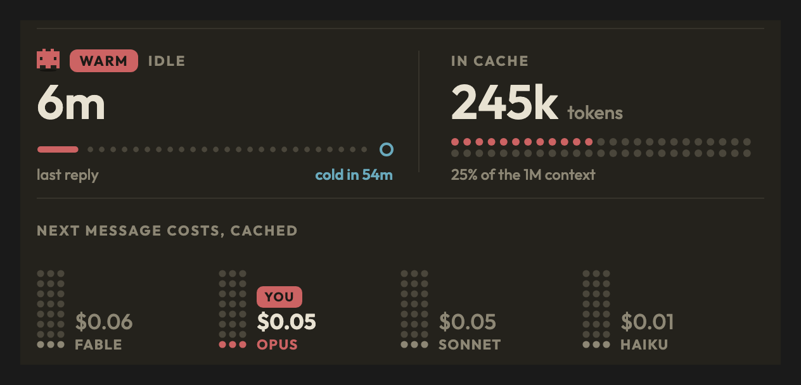

# claude-usage-mods

Five Claude Code mods for keeping an eye on usage, cost, subagents and background tasks while you work, and for switching what is loaded on or off.

| Mod | What it does | Toggle |
|---|---|---|
| `usage-band` | One-line band above the prompt: model, context fill, rate limits, cache warm/cold with time left and hit rate, cost, optional buttons for the panes | `/band-usage` |
| `agents-band` | Live rows for subagents, background shells and monitors, and linked sessions, stacked above the usage band | `/band-agents` |
| `flight-recorder` | Pane with a live timeline of each turn, per lane (main + subagents) | `/hud-flight-recorder` |
| `switchboard` | Pane with on/off switches for mods, plugins, skills and MCP servers | `/hud-switchboard` |
| `session-hud` | Pane with session cards: context, cost, cost per turn, tools used, files changed, what runs now; and the prompt cache card (warm or cold, size, next message cost) | `/hud-session`, `/hud-cache` |

Commands follow one scheme: `/hud-<name>` opens a pane, `/band-<name>` shows or hides a band.

## usage-band and agents-band



*Rendered from the band's layout and Robo's own drawing code, not captured from the app.*

**usage-band** is the bottom row: one line that answers "how much room and budget do I have left?" without running `/usage` or `/context`. From left to right:

- **Model** - the model the main loop is running, in Claude orange.
- **Context** - a bar, then how full the context window is in percent, then tokens used / window size.
- **5h / 7d** - percent used of each rate limit, then a countdown to its reset (`↻ 1h24m`). The `5h` and `7d` labels are blue.
- **Cache** - Robo, then `warm 54m` (minutes before the prompt cache goes cold) or `cold 2h5m` (how long it has been idle), then the hit rate: the share of this session's input tokens the cache served, every response counted, subagents included. Robo bobs while the cache is warm and sits frozen in ice once it is cold; pressing it opens the `/hud-cache` card. The clock restarts at each main-thread request (subagents keep their own cache), picks up a resumed session's idle time, and starts over on `/clear` and `/compact`. It assumes the 1 hour cache: a session on the 5 minute cache goes cold sooner than it shows.
- **Cost** - what this session has cost at API prices, after a 💰, in dim grey: an estimate, so it reads quietly.

**Narrow band.** Under 84 cells on desktop, or 100 in the terminal (the room a full line takes: the desktop counts wider cells, in a proportional font), each section keeps its number alone: the model, context %, `5h` and `7d` %, Robo with the hit %, and the cost without its 💰. The context bar, token counts, reset countdowns and the cache's word and time drop out. The terminal draws no Robo, so there the cache keeps its `warm` or `cold`.

The sections are spread evenly with a `│` midway between each pair. Context and limit percentages turn yellow at 50% and red at 80%; the cache hit rate goes the other way: green from 80%, yellow from 50%, red below. The band refreshes while you are idle, so the countdowns stay accurate, and it steps aside when a survey or question takes that spot.

**Buttons** sit at the end of the line, and they are off by default. Each one shows only once you turn it on and while its mod is loaded:

- **flight-recorder** (✈) opens the flight recorder pane.
- **switchboard** (⚙️) opens the Switchboard pane without adding a command to the transcript.
- **hud** (a gauge on desktop, `◆` in the terminal) opens the `session-hud` pane, also without a command in the transcript.

| Command | What it does |
|---|---|
| `/band-usage` | Hides or shows the whole band |
| `/band-usage open <pane>` | Opens that pane (`flight-recorder`, `switchboard` or `hud`), with or without its button |
| `/band-usage <button>` | Turns that button on when off, off when on (`flight-recorder`, `switchboard` or `hud`). Kept in new sessions |
| `/band-usage buttons` | Lists the buttons, on or off, and which mods aren't loaded |
| `/band-usage width` | Says how many cells each surface last drew the band in (`bodyColumns`), the layout it used, and the layout setting |
| `/band-usage width auto\|wide\|narrow` | `wide` or `narrow` holds that layout whatever the width; `auto` picks by width again. Kept in new sessions |

The command's hint lists the names as you type; the slash menu can't autocomplete arguments. Each pane's own command (`/hud-flight-recorder`, `/hud-switchboard`, `/hud-session`) opens it too. On desktop the buttons are 16 px grey icons, and the terminal draws them as glyphs.


**agents-band** is the top block. It appears only while there is something to show (subagents, background tasks or linked sessions), so it costs no space the rest of the time. Each subagent row shows:

- spinner while running, `✓` when done, `✗` when failed
- agent type and the task it was given
- model, then what it is doing right now (`thinking` or `▸ ToolName`)
- tool calls so far, tokens, elapsed time

The header counts running and finished agents. A finished agent stays visible for 20 seconds, then drops off. Up to 6 rows are shown.

**Background tasks**. Shell commands sent to the background (`run_in_background`, or Ctrl+B) and `Monitor` watches, from the main loop or any subagent, get a block of their own under the subagents:

- spinner while running, `✓` completed, `✗` failed, `■` killed
- `shell` or `monitor`, then the call's description (or its command)
- status and elapsed time

A row opens when the call returns a background task id. It closes when that task's notification arrives, or when `TaskStop` stops it, then lingers 20 seconds like a finished subagent. The end is read from the notification text in whichever conversation it lands, the main one or the subagent that started the task, so a task whose notification never reaches this session stays `running` until the session restarts.

**Linked sessions** (desktop app only). Sessions this one started with `start_session`, and the ones those started, get a block of their own under the subagents:

- spinner while the session is working, `○` when idle
- its short name and title
- model, `working` or `idle Nm ago`, and context fill (`ctx 23%`)

The data comes from the desktop app's `ccd_session_mgmt` MCP server (`list_sessions` with `linked: true`, `get_session`, `get_usage`), polled every 5 seconds. Archived sessions, the parent and sibling sessions are left out. In a terminal session that server does not exist: the first call says so and polling stops. Unlike subagents, a session's current tool and token count are not shown, since the server does not report them.

## flight-recorder


A side pane that records what happens inside each turn, so you can see where time and tokens went:

- **Turn header** - turn number, duration, cost, model requests, tool calls, total tokens, subagent count.
- **Lane timeline** - one row per lane: `main` plus each subagent (`gene a59e` = general-purpose agent `a59e…`). Bars are model requests, colored by model (opus, sonnet, haiku, fable). Tool calls are drawn on top, colored by kind (read, edit, shell, other). Dots mean nothing was running in that lane at that moment, for example main idle while its subagents work.
- **MODELS** - token share per model family for the turn.
- **Per-lane table** - requests, tool calls and tokens for each lane.

In the screenshot, main (opus) used 92% of the tokens for the turn and the two sonnet subagents only 8%. A spend split like that is the thing this pane makes easy to see.

Two views: **Text** (default, works in the terminal too) and **Dashboard** (SVG charts: cost per turn, tokens by model, top tools; desktop only). `/hud-flight-recorder text` or `/hud-flight-recorder dashboard` opens the pane on that view. Earlier turns are kept below the current one.



The Dashboard wears the same card as `/hud-cache`: a warm dark surface, the Outfit font, small uppercase labels over big figures, and rules between them. The model and tool colors are the dataviz reference palette, checked against that surface with its validator.

## switchboard

A side pane with an on/off switch for everything loaded into a session, in four tabs (`1`-`4` to switch):

| Tab | Lists | Off means | Takes effect |
|---|---|---|---|
| **Mods** | Mods loaded from `CLAUDE_CODE_PLUGIN_DIRS` and the session's dev-mods folder | Its `hooks/hooks.json` is backed up and pointed at a no-op stub; on restores it | Next session (dev-mods: at once) |
| **Plugins** | Installed marketplace plugins | `claude plugin disable` (on: `enable`) | Next session |
| **Skills** | Your skills, project skills, and each enabled plugin's | `Skill(<name>)` is added to `permissions.deny` in `~/.claude/settings.json` | Next session |
| **MCP** | MCP servers whose tools Claude can call, grouped by server | Switchboard refuses every call to that server and marks its tools as switched off | At once |

- Mods that open panels also get an eye button: hiding blocks their panes without switching them off.
- The first time it edits `~/.claude/settings.json` it keeps the original as `settings.json.switchboard-backup`.
- A blocked skill stays in Claude's list; calls to it are refused. A switched-off MCP server's tools are still listed, marked off.
- On desktop the pane takes the `/hud-cache` card's colors: a warm dark surface, cream titles, muted summaries, and switches drawn as warm red pills with a cream knob when on, dark with a grey knob when off. The terminal keeps its theme's colors and gets `━━● ON` / `○── OFF`.
- `/hud-switchboard on|off|hide|show <mod>` does the same from the prompt.

## session-hud



A side pane with one card per question, opened with `/hud-session` or the band's HUD button (Esc closes it). The button opens it with no `/hud-session` line in the transcript:

- **Context** - percent and tokens used of the window, with a meter that turns amber at 60% and red at 85%.
- **Cost** - what this session has cost, and what the last turn cost.
- **Cost per turn** - one bar per turn, with the last and average cost.
- **Tools** - the six busiest tools, each with its own color.
- **Files changed** - files Claude edited or wrote, with how many times.
- **Now** - the tool running right now, cut to one line of 60 characters. Keys, tokens and email addresses are masked before the cut.

It only observes and draws: no tool call or prompt is changed or refused. Counters live in the mod, so a reload of the mod starts them again from zero.

Desktop and mobile get one drawn card, scaled to the pane, in the `/hud-cache` look: big figures, dot meters, uppercase labels. Tools are colored by kind (read, edit, shell, other), the same as the flight recorder. The terminal gets fixed-width cards and `Raster` bars. The layout is picked by `e.surface`, not by which elements the surface offers, since the desktop table carries `Raster` too.

### Prompt cache card



`/hud-cache`, or pressing Robo in the band, opens a pane with the prompt cache up close: how long since the last request and when it goes cold, how many tokens the cache holds (as a share of the context window), and what the next message would cost on each model, yours marked YOU. Cold, it shows what re-caching the whole conversation costs. Prices are list-price estimates from a table in `session-hud/hooks/cache-art.ts`, not your bill. The terminal gets the same facts as text.

The card, Robo and the Outfit font come from [ribbon](https://github.com/robonuggets/ribbon) by Jay E | RoboNuggets (MIT, see `session-hud/LICENSE` and the `THIRD-PARTY-NOTICES` files).

### Origin

Trimmed from the `/hud` dashboard of StackSprint's [session-guard](https://github.com/stacksprint-io/claude-code-playbook/tree/main/mods/session-guard) 0.1.2 (MIT, see `session-hud/LICENSE`), without its status band, budget guard and recording mode.

## Install

1. Clone the repo anywhere, for example `~/.claude/mods`.
2. Point `CLAUDE_CODE_PLUGIN_DIRS` at the mods you want (`;` on Windows, `:` elsewhere), for example in `~/.claude/settings.json`:

```json
{
  "env": {
    "CLAUDE_CODE_PLUGIN_DIRS": "/path/to/usage-band:/path/to/agents-band:/path/to/hud-flight-recorder:/path/to/hud-switchboard:/path/to/session-hud"
  }
}
```

3. Restart Claude Code.

## Layout

Each mod has the same shape:

- `.claude-plugin/plugin.json` - manifest
- `hooks/hooks.json` + `hooks/register.tsx` - the mod itself
- `tests/` - tests using `claude-code/testing`
- `types/index.d.ts` - the mod's own public types

`.claude-plugin/types/` holds the Claude Code SDK type stubs. They are generated locally and git-ignored, so `tsconfig.json` only resolves once Claude Code has regenerated them (for example by asking it to work on the mod).
